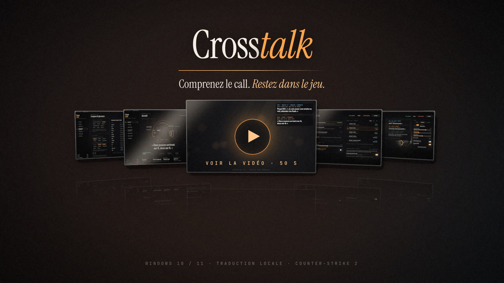

<div align="center">

<a href="https://cdn.jsdelivr.net/gh/aboalsim114/Crosstalk@media/showcase/crosstalk-showcase.mp4" title="Regarder la vidéo de présentation (50 s)"></a>

<sub>▶ <a href="https://cdn.jsdelivr.net/gh/aboalsim114/Crosstalk@media/showcase/crosstalk-showcase.mp4"><b>Voir la vidéo de présentation</b></a> · 50 s · 1080p · avec le son · <a href="https://github.com/aboalsim114/Crosstalk/raw/media/showcase/crosstalk-showcase.mp4">télécharger le MP4</a></sub>

<br />

**La communication n'a pas de frontière. Votre équipe non plus.**

Une application Windows pensée pour rendre les annonces vocales de **Counter-Strike 2** compréhensibles en français, sans quitter la partie.

<br />

[**↓ Télécharger Crosstalk pour Windows**](https://github.com/aboalsim114/Crosstalk/raw/downloads/Crosstalk-setup.exe) · [**Voir la version de test**](https://github.com/aboalsim114/Crosstalk/blob/downloads/VERSION.md) · [**Documentation**](docs/architecture.md)

<br />

   

</div>

---

## Comprenez l'essentiel. Concentrez-vous sur le round.

Une annonce en russe. Un *callout* en anglais. Une information décisive que vous n'avez pas comprise.

**Crosstalk transforme la parole détectée dans l'audio de CS2 en sous-titres français**, affichés dans un overlay discret. L'objectif : réduire la barrière de la langue, préserver votre attention et vous laisser jouer.

<p align="center"><a href="https://cdn.jsdelivr.net/gh/aboalsim114/Crosstalk@media/showcase/crosstalk-showcase.mp4"></a></p>

<table>
<tr>
<td width="33%" valign="top">

### 01 / Écouter
Capture audio Windows ciblée sur le processus CS2, sans intégration intrusive dans le jeu.

</td>
<td width="33%" valign="top">

### 02 / Comprendre
Détection de parole, transcription puis traduction vers le français, directement sur votre PC.

</td>
<td width="33%" valign="top">

### 03 / Continuer à jouer
Un overlay transparent conçu pour afficher les sous-titres sans prendre le contrôle des clics.

</td>
</tr>
</table>

> **État actuel — version de développement.** Le pipeline vocal fonctionne avec des sources audio réelles, mais peut aussi détecter les tirs, effets sonores et autres bruits du jeu. L'isolation fiable des voix, la précision des traductions et la latence en conditions réelles sont encore en cours de validation. Le chat écrit est lu dans `console.log` de CS2 (option `-condebug`) ; son format reste à confirmer en partie réelle. Ne considérez pas ce build comme une version stable.

## Une expérience de bureau, pensée pour le jeu

| | Expérience |
| --- | --- |
| **Répondez dans leur langue** | En pleine partie, **Ctrl+Alt+F6** : **dites** votre phrase en français, ou **Ctrl+Alt+F7** : écrivez-la, Crosstalk traduit en anglais ou en russe (la langue entendue chez vos coéquipiers) et copie le message. Dans CS2 : Y ou U, Ctrl+V, Entrée. Les annonces courantes (« éco », « drop-moi », « deux en B »…) sont traduites à la main, instantanément ; rien n'est tapé dans le jeu à votre place. |
| **Radar des annonces** | « Двое на банане » : la zone **Banana** s'allume sur le plan d'Inferno dans l'overlay, avec **×2**. Les callouts dits ou écrits par vos coéquipiers (russe, anglais, raccourcis de chat comme « 2 B ») deviennent une carte que vous lisez d'un coup d'œil. 9 cartes, plans schématiques, rien n'est lu dans le jeu ([détails](docs/radar.md)). |
| **Voix IA en jeu** | **Ctrl+Alt+F6**, dites « Deux en B » : vos coéquipiers russes entendent « Двое на B » dans le vocal de CS2, dit par une voix neuronale au choix (Piper, homme ou femme). Transcription, traduction et voix sur votre PC : gratuit, sans compte ni clé. Passe par le câble audio virtuel gratuit VB-CABLE ; rien n'est appuyé dans le jeu à votre place. Désactivé par défaut ([détails](docs/voice-ai.md)). |
| **Mode streamer** | Vos viewers lisent aussi les annonces en français : Crosstalk sert une page locale (`http://127.0.0.1:31983/`) à ajouter dans OBS comme **source navigateur**. Pseudos masqués par défaut, phrase originale en option, désactivé tant que vous ne l'activez pas. |
| **Qui parle ? (expérimental)** | « Sasha — deux en B » : Crosstalk lit le pseudo affiché par l'indicateur de voix de CS2, uniquement sur une petite zone de **votre écran**, avec l'OCR intégré à Windows. Aucun accès au jeu, aucune image enregistrée. Pas de pseudo en cas de doute. Désactivé par défaut. |
| **Résumé de partie à partager** | À la fin du match, une image soignée : carte, score, nombre d'annonces traduites par langue, latence, et la **carte des annonces** : les zones citées par votre équipe pendant le match, en lueurs sur le plan ([exemple](docs/radar.md#carte-des-annonces-de-la-partie)). Bouton « Copier l'image » à coller dans Discord, ou enregistrement dans Documents. Aucun pseudo dessus, rien n'est envoyé. |
| **Focus voix (expérimental)** | Les coéquipiers parlent au centre du son, les tirs et les pas viennent des côtés : Crosstalk garde le centre et baisse le reste avant la transcription. +4 à +8 dB de clarté au banc d'essai, pour moins de 1 % de processeur. Désactivé par défaut. |
| **Traduction dans votre langue** | Au premier lancement, vous choisissez la langue dans laquelle vous lisez (français, anglais, russe, allemand, espagnol, ukrainien) et celles de vos coéquipiers (les mêmes, plus polonais et turc). Votre propre langue n'est jamais traduite ; sans modèle direct, la traduction passe par l'anglais ([détails](docs/languages.md)). |
| **Interface en plusieurs langues** | Français, English, Español, Deutsch, Português (Brasil), Русский, Polski, Türkçe, 简体中文, ou la langue de Windows (automatique). Traduction en cours, écran par écran ([détails](docs/i18n.md)). |
| **Overlay en jeu** | Fenêtre transparente, repositionnable, avec clics traversants par défaut. Fonctionne avec CS2 en mode fenêtré sans bordures. |
| **Contrôle immédiat** | Affichez ou masquez l'overlay, mettez en pause ou déclenchez l'arrêt d'urgence via des raccourcis globaux. |
| **Discret par conception** | Crosstalk peut continuer à fonctionner dans la zone de notification lorsque sa fenêtre principale est masquée. |
| **Reconnaissance et traduction locales** | Pipeline WASAPI → Silero VAD → whisper.cpp → Opus-MT. Whisper tourne sur la **carte graphique** (Vulkan : NVIDIA, AMD, Intel) quand elle est compatible, sinon sur le processeur. Aucun compte, aucune clé API ni abonnement requis pour ce traitement. |
| **Traduction en ligne (facultative)** | Désactivée par défaut. Vous pouvez confier les phrases au LLM de votre choix, avec votre propre clé : API compatibles OpenAI (OpenAI, OpenRouter, Mistral, Groq, Ollama, LM Studio…) ou Anthropic. Seul le texte des phrases est envoyé, jamais l'audio ni les pseudos. La clé reste dans le Gestionnaire d'identifiants Windows. Opus-MT prend le relais à la moindre erreur ([détails](docs/translation-llm.md)). |
| **Vraie application Windows** | Interface React + TypeScript intégrée dans Tauri v2, cœur natif Rust, rendu via WebView2. Ce n'est pas un site web. |

### Le respect du jeu fait partie du produit

Crosstalk est un outil **externe**. Il n'injecte pas de code dans `cs2.exe`, ne lit pas la mémoire du jeu et n'intercepte pas son trafic réseau. La capture audio s'appuie sur des interfaces Windows documentées. Cela ne constitue **pas** une garantie d'approbation officielle par Valve ou d'absence de risque avec les règles et systèmes anti-triche : utilisez-le en connaissance de cause.

---

## Télécharger Crosstalk

### Windows · x64 · Development preview

**[↓ Télécharger l'installateur Crosstalk-setup.exe](https://github.com/aboalsim114/Crosstalk/raw/downloads/Crosstalk-setup.exe)**

1. **Téléchargez** `Crosstalk-setup.exe` depuis la branche de distribution `downloads`.
2. **Installez** Crosstalk dans le dossier proposé ou celui de votre choix. L'installateur met en place l'application, les raccourcis et **télécharge tous les modèles** pendant l'installation : détection de voix, Whisper base et small, traduction russe et anglais → français, et français → anglais et russe pour vos réponses (environ **1,9 Go**, une seule fois).
3. **Lancez** Crosstalk puis ouvrez CS2 : tout fonctionne hors ligne, sans aucun téléchargement supplémentaire.
4. **Mises à jour : depuis l'application.** À partir du build 94, Crosstalk vérifie au lancement (puis toutes les 6 h) s'il existe une version plus récente et propose de l'installer : il télécharge l'installateur, vérifie sa taille et son empreinte SHA-256, puis se met à jour au même endroit et redémarre, modèles et réglages conservés. Plus besoin de revenir sur cette page.

**Avant l'installation :** ce build de test n'est pas signé numériquement et peut déclencher un avertissement SmartScreen. Vérifiez la provenance et, si nécessaire, comparez son empreinte SHA-256 avec la [fiche de distribution](https://github.com/aboalsim114/Crosstalk/blob/downloads/VERSION.md) avant de décider de l'exécuter.

| Distribution | Usage |
| --- | --- |
| [**Installateur de développement**](https://github.com/aboalsim114/Crosstalk/raw/downloads/Crosstalk-setup.exe) | Tester l'expérience Windows et la capture/traduction actuelle. |
| [**Fiche du build et SHA-256**](https://github.com/aboalsim114/Crosstalk/blob/downloads/VERSION.md) | Identifier le commit, la date de compilation et contrôler les téléchargements. |
| [**Flux de mise à jour**](https://github.com/aboalsim114/Crosstalk/blob/downloads/latest.json) | Lu par l'application : numéro de build, nouveautés, empreinte de l'installateur. |
| [**Outils Windows portables**](https://github.com/aboalsim114/Crosstalk/raw/downloads/crosstalk-windows-x64-portable.zip) | Diagnostics audio, banc d'essai ASR et tests de traduction. |
| [**Releases GitHub**](https://github.com/aboalsim114/Crosstalk/releases) | Versions publiées depuis la branche de production, lorsqu'elles sont disponibles. |

**À noter :** le dépôt est public, les liens fonctionnent sans compte GitHub. La branche `downloads` peut être en retard sur `develop` : consultez `VERSION.md` pour connaître le commit exact du build. Le runtime WebView2 est pris en charge par les installateurs Windows si nécessaire.

### Commandes essentielles en jeu

| Raccourci | Action |
| :--- | :--- |
| `Ctrl + Alt + F8` | Afficher / masquer l'overlay |
| `Ctrl + Alt + F9` | Mettre en pause / reprendre |
| `Ctrl + Alt + F10` | Arrêt d'urgence des captures |

Ces raccourcis utilisent `RegisterHotKey`, sans hook clavier. Un éventuel conflit de raccourcis peut être consulté dans **Diagnostic**.

---

## Ce qui fonctionne et ce qui arrive

| Capacité | Statut | Détail |
| --- | --- | --- |
| Détection de `cs2.exe` et capture audio de processus | **Implémenté · en test** | WASAPI process loopback, Windows compatibles. |
| Détection de parole et transcription RU / EN | **Implémenté · en test** | Silero VAD et whisper.cpp ; séparation parole / sons du jeu encore imparfaite. |
| Traduction vocale vers le français | **Implémenté · en test** | Opus-MT local ; qualité et délais à mesurer sur des matchs réels. |
| Traduction en ligne par un LLM (votre clé) | **Implémenté · à valider** | Désactivée par défaut. Testée avec un fournisseur simulé uniquement ; à essayer avec une vraie clé sous Windows. |
| Overlay Windows et commandes rapides | **Implémenté** | Fenêtre transparente et raccourcis globaux. |
| Identification fiable du joueur qui parle | **Expérimental / à valider** | Approche HUD et OCR prévue ; ne pas présumer qu'un pseudo est correctement identifié. |
| Chat écrit de CS2 et traduction | **Implémenté · en test** | Lecture de `console.log` (option de lancement `-condebug`, vérifiée dans Steam) ; format des lignes à confirmer en partie réelle, règles modifiables sans nouvelle version. |
| Version Windows stable et signée | **Non disponible** | Builds de test uniquement à ce stade. |

Le cap produit est simple : **moins de bruit, des traductions utiles, et un minimum d'interruption pendant le jeu.** Les performances visées dans le cahier des charges ne sont pas des résultats mesurés.

## Sous le capot

<div align="center">

`Counter-Strike 2` → `WASAPI` → `Silero VAD` → `whisper.cpp` → `Opus-MT` → `Overlay`

</div>

La capture ciblée récupère l'audio attribué au processus CS2 — **y compris les sons du jeu**, pas exclusivement la voix de vos coéquipiers. Le pipeline tente ensuite d'identifier les segments de parole avant de les transcrire et de les traduire. Les fonctions à venir sont décrites dans le [cahier des charges v2.0](docs/cahier-des-charges.md) et l'[architecture cible](docs/architecture.md) ; le code actuel est décrit dans [docs/architecture/](docs/architecture/overview.md).

### Stack technique

| Couche | Technologie |
| --- | --- |
| Application native | **Tauri v2 · Rust** |
| Interface | **React · TypeScript · Tailwind CSS** |
| Direction artistique et animation | **Motion · Three.js** |
| Capture / fonctionnalités Windows | **WASAPI process loopback · WebView2 · APIs Windows** |
| Intelligence vocale locale | **Silero VAD · whisper.cpp · Opus-MT** |
| Tests | **Vitest · Cargo tests · scripts de validation Windows** |

### Structure du dépôt

```text
Crosstalk/
├── src/               # Interface React
│   ├── app/           #   fenêtre principale : coquille, store de session, ponts natifs
│   ├── features/      #   une fonctionnalité par dossier (audio, speech, translation, chat…)
│   ├── shared/        #   appels Tauri (ipc), langues de l'interface (i18n), atomes (ui)
│   ├── windows/       #   fenêtres overlay et Répondre
│   └── installer/     #   interface de l'installateur
├── src-tauri/         # Cœur Rust : un module par fonctionnalité, câblés dans wiring.rs
├── src-installer/     # Installateur personnalisé séparé
├── docs/              # Architecture, développement, cahier des charges, protocoles de test
├── design/            # Maquettes et archives de conception
├── scripts/           # Validation locale, contrôles, publication et bancs d'essai
└── CONTRIBUTING.md    # Workflow de contribution
```

Architecture du code : [docs/architecture/overview.md](docs/architecture/overview.md). Démarrer : [docs/development/getting-started.md](docs/development/getting-started.md).

## Développer en local

**Prérequis :** Windows 10/11 x64, Node.js 22, Rust stable avec toolchain **MSVC**, Visual Studio Build Tools (développement desktop C++), LLVM / `LIBCLANG_PATH` et CMake.

```powershell
npm install
npm run app:dev        # application Tauri et rechargement à chaud
npm test               # tests React / TypeScript
npm run typecheck      # contrôle des types
```

Pour les tests Rust et le build, depuis la racine du dépôt :

```powershell
cd src-tauri
cargo test --all-targets --locked
cd ..
npm run app:build
```

Les bundles Tauri sont générés dans `src-tauri/target/release/bundle/` (`nsis/` et `msi/`). Le projet comporte également un **installateur personnalisé** distinct, documenté dans l'architecture.

### Validation locale · sans GitHub Actions

```powershell
powershell -ExecutionPolicy Bypass -File scripts\validate.ps1
```

La validation couvre les contrôles anti-triche et d'architecture du dépôt, les vérifications TypeScript, les tests (application et installateur), `rustfmt`, `clippy`, la compilation Windows et les bundles prévus par le script. Un rapport est généré dans `dist-local\<commit>\validation.md`. Les vérifications audio et les essais réels dans CS2 restent manuels et doivent être rapportés séparément.

`npm run dev` lance seulement l'interface web pour la conception ; **le produit livré est l'application desktop Tauri**.

## Contribuer et publier

```text
main             → production / releases validées
  ↑
develop          → intégration du développement
  ↑
feat/* · fix/* · chore/* → branches de travail, Pull Requests
```

Chaque modification suit une branche dédiée et une Pull Request ciblant `develop`. La branche `main` reste réservée aux releases approuvées. **Aucune GitHub Actions n'est utilisée** : les validations et compilations sont réalisées localement sur Windows. Les versions de production sont publiées via tags `vx.y.z` et Releases GitHub après validation du mainteneur.

Lire **[CONTRIBUTING.md](CONTRIBUTING.md)** pour les règles de branches, les rapports de test et le processus de publication.

---

<div align="center">

### **CROSSTALK**

*La bonne information. Au bon moment. Dans votre langue.*

<sub>Independent Windows desktop project for Counter-Strike 2. Not affiliated with, endorsed by, or sponsored by Valve.</sub>

</div>
