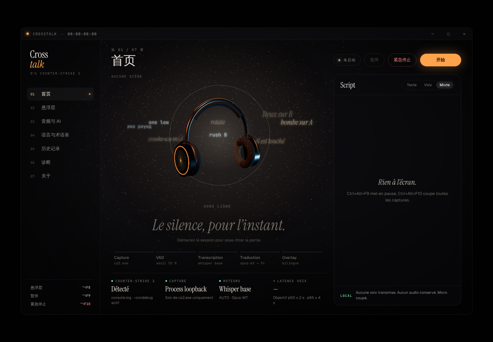
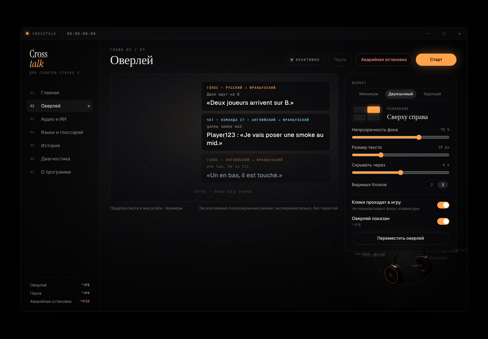

# Langues de l'interface

Crosstalk choisit la langue de ses menus et de ses écrans dans **Langues & glossaire › Langue de l'application**. On peut choisir **Automatique**, qui suit la langue de Windows et bascule sur l'anglais si elle n'est pas proposée, ou l'une des langues suivantes : français, anglais, espagnol, allemand, portugais (Brésil), russe, polonais, turc, chinois simplifié. Le choix est enregistré dans `config.json`.

La langue de l'interface est **indépendante** de la langue des sous-titres. Les sous-titres sont traduits dans la langue choisie dans **Mes langues** ([languages.md](languages.md)), indépendamment de la langue des menus.

## État de la traduction

La traduction se fait écran par écran. Tant qu'elle n'est pas terminée, la langue par défaut reste le **français**, pour qu'un utilisateur ne tombe pas sur un écran à moitié traduit. Elle passera à **Automatique** quand tous les écrans seront faits.

| Partie | État |
|---|---|
| Moteur (`src/shared/i18n`), sélecteur, mémorisation | ✅ |
| Menu latéral, barre de titre, en-tête des pages, boutons de session, raccourcis | ✅ |
| Menu de la zone de notification (Windows) | ✅ (textes envoyés au cœur Rust, `ui_set_tray_labels`) |
| Accueil, Overlay (dont la carte Mode streamer), overlay en jeu, états de la capture, de CS2, du moteur, de la traduction et du chat | ✅ |
| Audio & IA | à faire |
| Langues & glossaire, Historique, Diagnostic, À propos | à faire |
| Fenêtre « Répondre » | à faire |
| Messages venant du cœur Rust (états, erreurs) | à faire |
| Installateur | à faire |

Les étiquettes des sous-titres (« VOIX • RUSSE → FRANÇAIS ») et les guillemets suivent la langue de l’interface (« … », “…”, „…“). Le texte des sous-titres est dans la langue choisie dans « Mes langues ».

## Fonctionnement technique

- **Source** : `src/shared/i18n/locales/fr.ts`. Les clés sont plates (`'nav.dash'`), avec des paramètres `{nom}`. Un pluriel est un objet `{ one, few, many, other }`, choisi par `Intl.PluralRules` ; cela gère par exemple les trois formes du russe et du polonais.
- **Chaque langue** (`en.ts`, `ru.ts`…) est typée `Messages`. Une clé manquante empêche la compilation (`tsc`). `i18n.test.tsx` vérifie en plus que les textes ne sont pas vides et que les paramètres `{…}` sont identiques à ceux du français.
- **Dans un composant** : `const t = useT();` puis `t('nav.dash')`. Le composant se réaffiche quand la langue change. Hors React : `t()` importé de `src/shared/i18n`.
- **Sans dépendance** : pas d'i18next ; le moteur fait une centaine de lignes.

## Ajouter ou corriger une langue

1. Copier `src/shared/i18n/locales/en.ts` vers `xx.ts`, renommer la constante, traduire les valeurs. Ne pas toucher aux clés ni aux `{paramètres}`.
2. Ajouter la langue à `LOCALES` et à `MESSAGES` dans `src/shared/i18n/index.ts`, ainsi qu'au type `Locale`.
3. `npm run typecheck && npm test`.

Les traductions actuelles, hors français, n'ont pas encore été relues par des locuteurs natifs. Les corrections sont bienvenues.
