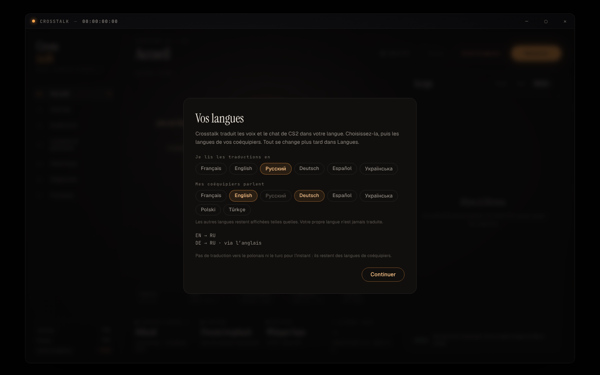
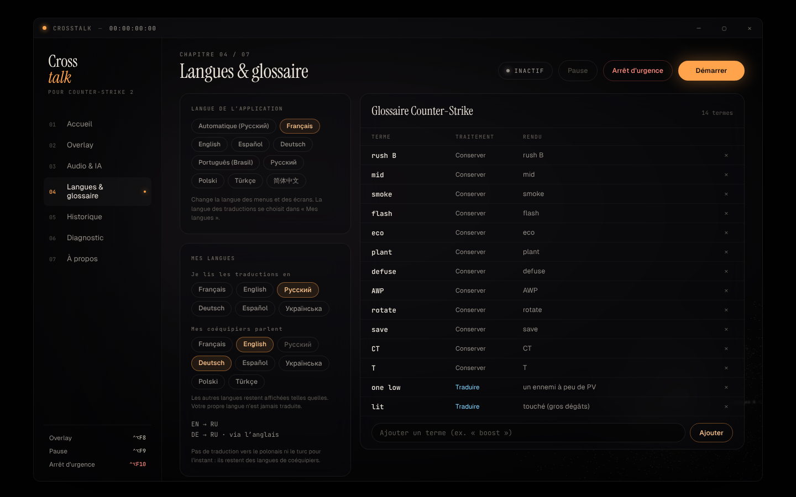

# Mes langues : traduire dans sa propre langue

Crosstalk traduit les voix et le chat de CS2 **dans la langue de l'utilisateur**, depuis les langues de ses coéquipiers. Au premier lancement, une fenêtre « Vos langues » demande :

- **Je lis les traductions en** : français, English, Русский, Deutsch, Español, Українська, Polski ou Türkçe. La langue de Windows est proposée d'office.
- **Mes coéquipiers parlent** : une ou plusieurs langues parmi Français, English, Русский, Deutsch, Español, Українська, Polski et Türkçe.

Vient ensuite le choix du moteur de traduction (API Cloud, Ollama, LM Studio ou plus tard, voir [translation-llm.md](translation-llm.md)). Tout se change ensuite dans **Langues & glossaire › Mes langues**.

## Ce qui est traduit

| Ligne entendue ou lue | Résultat |
|---|---|
| Dans une langue de coéquipier choisie | Traduite dans votre langue |
| Dans votre propre langue | Affichée telle quelle, jamais traduite |
| Dans une autre langue | Affichée telle quelle, avec « langue non choisie » |

- Whisper ne reconnaît que les langues choisies et la vôtre : il confond moins les langues sur les annonces courtes.
- Le chat écrit reconnaît les mêmes huit langues, d'après l'alphabet, les lettres propres à chaque langue (ukrainien « і ї є ґ », polonais « ą ę ł », turc « ğ ı ş »…) et des mots fréquents. Un message trop court pour savoir reste tel quel.
- Les annonces CS du lexique (« rush B », « two on A »…) restent instantanées **quand vous lisez en français** : leur traduction est écrite en français. Dans les autres langues, le LLM les traduit.
- Les termes du glossaire marqués « Conserver » sont gardés dans toutes les langues. Les rendus imposés fournis avec Crosstalk sont en français : ils ne sont appliqués qu'en français. Ceux que vous ajoutez sont appliqués partout.

## Moteur

Toutes les paires sont traduites **directement** par le LLM connecté (Audio & IA › Traduction IA) : il n'y a plus de modèle par paire, plus de passage par l'anglais et plus rien à télécharger quand vous changez de langue. Sans moteur connecté, les lignes restent dans leur langue d'origine.

## Répondre dans leur langue

Vous écrivez ou dictez **dans votre langue**, et Crosstalk traduit vers la langue de vos coéquipiers. Les langues de réponse possibles sont celles de vos coéquipiers, la vôtre exceptée. Le texte libre demande un moteur connecté ; sinon la fenêtre l'indique.

Les phrases CS toutes faites (« Éco », « Drop-moi une arme »…) restent proposées en français uniquement, vers l'anglais ou le russe.

## Limites

- **Non testé sur un vrai PC Windows ni en partie** avec un vrai fournisseur ou un vrai Ollama / LM Studio : les tests utilisent des serveurs simulés.
- La qualité dépend du modèle choisi ; un petit modèle local peut être moins précis sur les langues rares.
- Les écrans Audio & IA, Historique, Diagnostic et la fenêtre « Répondre » restent en français (traduction de l'interface en cours, voir [i18n.md](i18n.md)).
