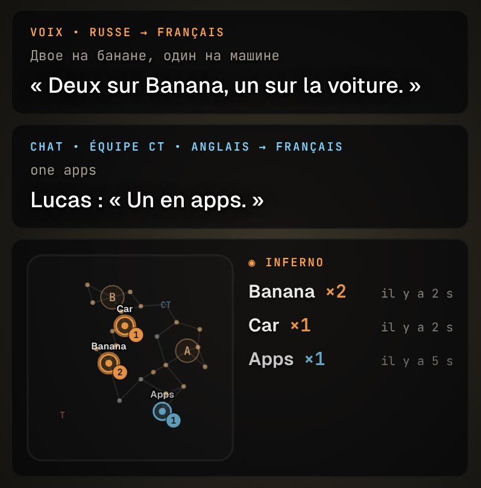
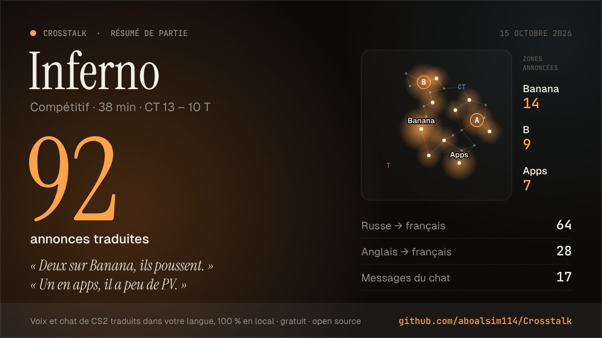

# Radar des annonces

Quand un coéquipier dit « двое на банане » ou écrit « 2 B » dans le chat, la zone s'allume sur un plan de la carte, dans l'overlay, avec le nombre d'ennemis annoncé. Vous voyez où ça se passe sans lire la phrase.

Rendu de l'overlay avec des lignes d'exemple (pas une capture en partie).

## Fonctionnement

1. **La carte** vient de l'intégration de CS2 (Game State Integration, Audio & IA › carte jouée). Sans elle, le radar ne sait pas sur quelle carte vous jouez et ne s'affiche pas.
2. **Chaque ligne finale**, voix ou chat, est analysée deux fois : dans sa langue d'origine, puis dans sa traduction.
   - L'original passe en premier, c'est ce qui a été dit.
   - La traduction complète : elle garde les callouts en anglais (« Banana »), même quand la reconnaissance vocale a mal écrit le mot russe.
   - Les mots provisoires (ligne en cours) sont ignorés.
3. **Les zones** sont reconnues par leur nom anglais et leurs formes russes, terminaisons comprises (`банан*` : банан, банане, бананом). Les sites A et B le sont aussi : « на А », « rush A », « A site », « плент Б », « 2 B ».
   - Pour A, l'article anglais (« at a corner ») et la conjonction russe (« а ты иди ») sont écartés : il faut une préposition, le mot « site », ou une ligne très courte.
   - Le français « il en a deux » n'est pas un site.
4. **Le nombre** d'ennemis est le nombre dit juste avant la zone (jusqu'à trois mots : « двое идут на B »), ou juste après (« B two »).
   - Il est lu en chiffres (1 à 5), en anglais, en russe (один, двое, троих…) et en français (deux à cinq ; « un » est écarté, car c'est aussi l'article).
5. **Une zone reste allumée** 12 s par défaut (réglable de 6 à 20 s) et s'estompe peu à peu. Une zone annoncée de nouveau se rallume ; un anneau marque les annonces de moins de 2,5 s. Orange : voix ; bleu : chat.

Le radar n'apparaît dans l'overlay que lorsqu'une zone est allumée, ou pendant le repositionnement. Les sous-titres restent du côté du bord de l'écran.

## Cartes

Mirage, Inferno, Dust II, Nuke, Ancient, Anubis, Vertigo, Overpass, Train : les cartes de `src-tauri/src/gsi/maps.json`.

Les plans sont **schématiques**, dessinés à la main (`src/features/radar/layouts.ts`) : un point par callout, placé à peu près comme sur le radar du jeu, et des traits vers les deux voisins les plus proches. Aucun fichier du jeu n'est lu ni distribué. Les positions sont approximatives ; corrections bienvenues.

## Carte des annonces de la partie

Le résumé de partie (Historique › Résumé de partie) dessine aussi **toutes les zones annoncées pendant le match** sur le plan de la carte :
- une lueur orange par zone, d'autant plus grande que la zone a été citée souvent (surface proportionnelle à la racine du nombre, pour qu'une zone n'écrase pas les autres) ;
- le nom des trois zones les plus citées sur le plan ;
- leur nombre de citations à côté.

Image d'exemple : partie inventée, rendue par le code du résumé.

Chaque ligne finale (voix ou chat) compte une fois pour chaque zone qu'elle nomme. La carte n'apparaît que sur une carte connue, quand au moins une zone a été annoncée. L'interrupteur « Carte des annonces », sous l'image, la retire. Comme le reste du résumé : aucun pseudo, rien n'est envoyé.

## Respect du jeu

Le radar n'affiche que ce que disent vos coéquipiers, déjà transcrit et traduit par Crosstalk. Il ne lit ni la mémoire du jeu, ni les positions des joueurs : la Game State Integration ne fournit à Crosstalk que la carte (`"map" "1"`).

## Réglages

Overlay › Radar des annonces :

- interrupteur (activé par défaut) ;
- durée d'allumage ;
- aperçu en direct ;
- bouton « Essayer », qui affiche un exemple sur Mirage, aussi dans l'overlay.

## Code

| Fichier | Rôle |
| --- | --- |
| `src/features/radar/layouts.ts` | plans et noms des zones |
| `src/features/radar/detect.ts` | zones et nombres d'une ligne |
| `src/features/radar/radar.ts` | zones allumées dans le temps, état envoyé à l'overlay |
| `src/features/radar/RadarView.tsx` | dessin du plan (SVG) et panneau de l'overlay |
| `src/features/radar/RadarCard.tsx` | carte de réglages |

Tests : `src/features/radar/radar.test.ts` (détection : russe, anglais, raccourcis de chat, faux positifs) et `RadarCard.test.tsx` (réglages, overlay, carte).

## Limites

- La détection repose sur des mots-clés : une zone citée sans ennemi (« je vais en B ») s'allume aussi. Le panneau affiche « Apps ×2 » seulement quand un nombre est dit.
- La qualité dépend de la transcription : un callout mal reconnu par la reconnaissance vocale n'allume rien.
- Pas encore testé en partie réelle sous Windows : les phrases des tests sont écrites à la main.
