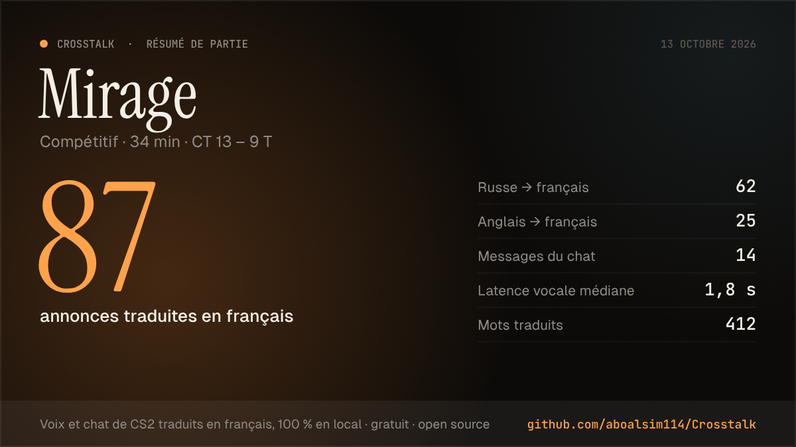
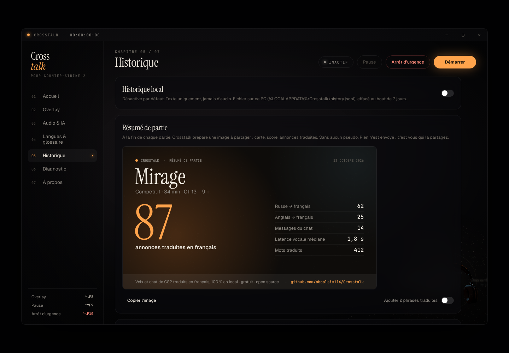

# Protocole de test : résumé de partie

*Image produite par `src/features/recap/card.ts` dans Chromium, avec des **données de démonstration** : ce n'est pas une vraie partie.*

## Fonctionnement

Une partie commence quand CS2 charge une carte. Il faut pour cela que le nom de la carte soit activé : Langues & glossaire › Game State Integration. Elle se termine quand CS2 annonce la fin du match (phase `gameover`, avec le score final). Sans le nom de la carte, une session (Démarrer → Arrêter) compte comme une partie.

Pendant la partie, Crosstalk compte les lignes finales :
- annonces traduites, par langue d'origine ;
- messages du chat ;
- mots traduits ;
- latence vocale médiane.

À la fin, un message « Résumé de <carte> prêt » s'affiche et la carte apparaît dans **Historique › Résumé de partie**.

Garanties :
- **aucun pseudo** n'apparaît sur l'image ;
- les phrases traduites n'y sont ajoutées que si l'utilisateur active « Ajouter 2 phrases traduites » (traductions seulement, sans nom) ;
- rien n'est envoyé : l'utilisateur copie l'image ou l'enregistre dans `Documents\Crosstalk-resume-<date>.png`.

Le score vient du bloc `map` de Game State Integration, le seul que Crosstalk demande (aucune donnée de joueur).

## Étapes (Windows, CS2)

| # | Action | Résultat attendu |
| --- | --- | --- |
| 1 | Historique, sans partie jouée | « Aucune partie pour l'instant… » |
| 2 | Activer le nom de la carte (Langues & glossaire), démarrer une session, lancer une partie | Historique : « Partie en cours : le résumé apparaît dès la première ligne traduite », puis un aperçu qui se met à jour. |
| 3 | Jouer jusqu'à la fin du match | Message « Résumé de <carte> prêt · onglet Historique ». Carte avec la carte jouée, le mode, la durée, le score `CT x – y T` et les chiffres de la partie. |
| 4 | **Copier l'image**, puis Ctrl+V dans Discord | L'image est collée dans le message. |
| 5 | **Enregistrer dans Documents**, puis **Afficher le fichier** | `Crosstalk-resume-<date>.png` sélectionné dans l'explorateur. |
| 6 | Activer « Ajouter 2 phrases traduites » | Deux traductions entre guillemets sur l'image, sans aucun pseudo. |
| 7 | Rejouer une partie sur la même carte | Nouvelle partie comptée à partir de zéro (échauffement après la fin du match). |
| 8 | Sans le nom de la carte : Démarrer, quelques lignes traduites, Arrêter | Résumé « Session CS2 », sans score. |
| 9 | Partie sans aucune ligne | Pas de résumé (rien à partager). |
