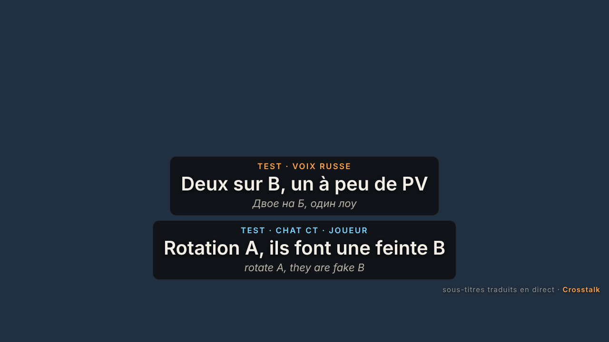

# Protocole de test : mode streamer (OBS)

Sur Windows, avec Crosstalk et OBS Studio installés.

*Rendu de la page dans Chromium avec deux lignes de test (pas une vraie partie).*

| # | Action | Résultat attendu |
| --- | --- | --- |
| 1 | Overlay › carte « Mode streamer » | Désactivé ; `http://127.0.0.1:31983/` ne répond pas dans un navigateur. |
| 2 | Activer « Afficher les sous-titres sur le stream » | État « Prêt · en attente d'OBS ». Le réglage est conservé après un redémarrage. |
| 3 | OBS › Sources › + › Navigateur › URL copiée, 1920 × 1080 | L'état passe à « OBS connecté ». La source est transparente. |
| 4 | Cliquer **Envoyer une ligne de test** | Dans OBS : « TEST · VOIX RUSSE / Deux sur B, un à peu de PV », puis disparition après la durée choisie. Mention « Crosstalk » en bas à droite. |
| 5 | Session réelle (voix et chat) | Chaque sous-titre final apparaît dans OBS, sans pseudo ni phrase originale par défaut ; les mots « EN DIRECT » provisoires n'y sont pas. |
| 6 | Activer « Afficher les pseudos », « Afficher la phrase originale » ; changer taille, durée, lignes | OBS se met à jour immédiatement, sans recharger la source. |
| 7 | Désactiver le mode | La page OBS se vide ; plus rien n'est envoyé. |
| 8 | Ouvrir `http://<IP du PC>:31983/` depuis un autre appareil du réseau | Inaccessible (écoute sur 127.0.0.1 uniquement). |
